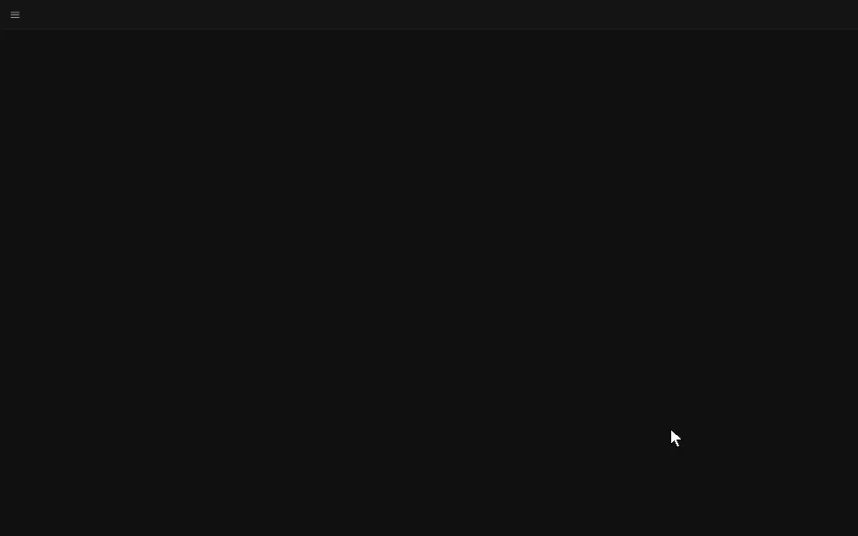
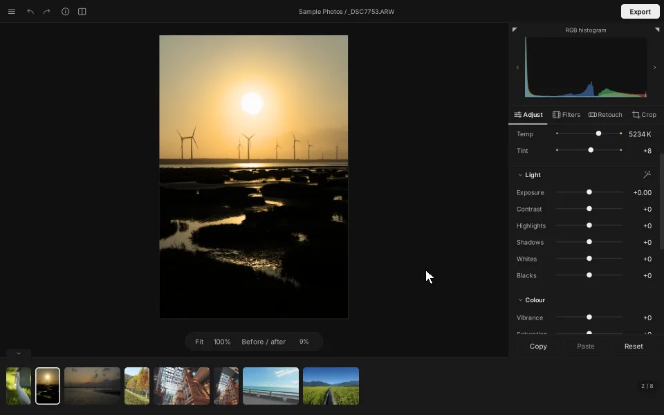
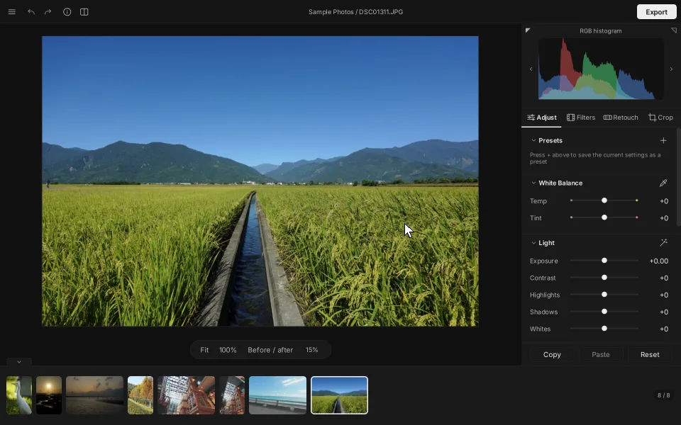
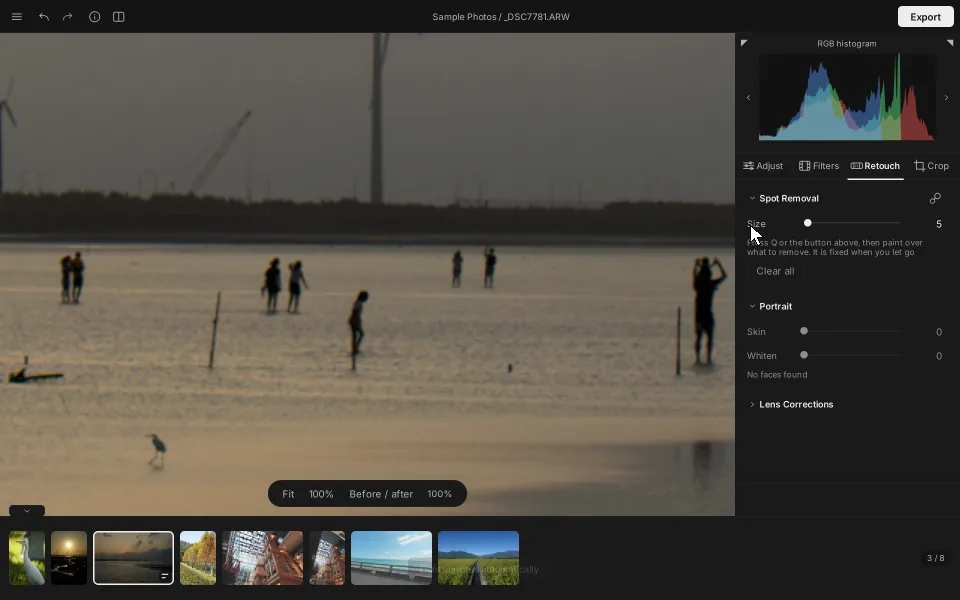
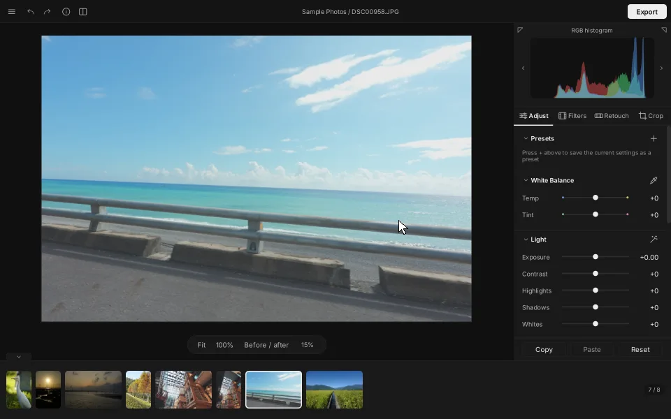
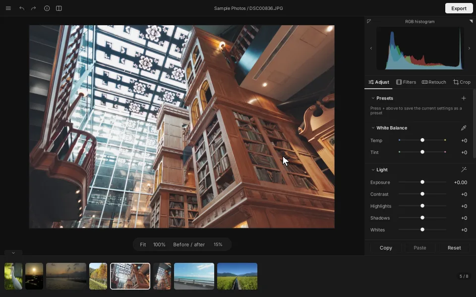
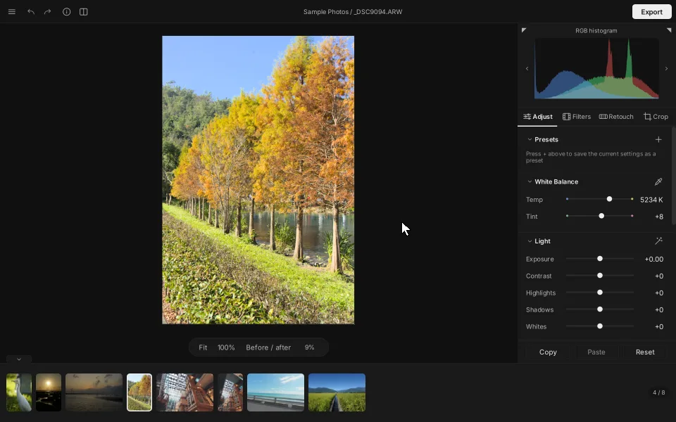

<div align="center">


# TintaPhoto

**Are you ready to tint your memories with captivating colours?**

A RAW photo editor for Windows, made for people who love taking pictures.<br>
Light, quiet, and devoted to one thing: making a photograph look the way it felt.

[](#system-requirements)
[](LICENSE)
[](LICENSE)
[](#system-requirements)

### [⬇&nbsp; Download free for Windows](https://github.com/FEXAQAQ/tintaphoto/releases/latest)

[繁體中文](README.md) · [Download and install](#download-and-install) · [Getting started](#getting-started) · [Changelog](CHANGELOG.md)

<br>



</div>

<br>

## About

When you press the shutter you see more than a picture —<br>
you see the warmth of the day, the air, the light falling just so.

Then you get home, and the photo on the screen is grey, flat, missing something.

**TintaPhoto is here to bring that moment back.**

Open a folder and your photos line up along the bottom. Nudge a slider and the
detail hiding in the shadows rises to meet you; tap a filter and the whole frame
looks as if it were shot on a different roll of film.
No library to build, no catalogue to import, no subscription — open, adjust,
export, done. And your original files are never touched, not by a single bit.

<br>

---

<br>

<div align="center">

<sub>L I G H T</sub>

### Everything in the shadows is still there

</div>



A RAW file keeps everything the camera saw, even the parts that look black.
Press the wand on the Light group (`Ctrl+U`) and exposure, highlights, shadows,
whites and blacks are set from the photo itself; then lift the shadows a little
more and add some vibrance by hand — the preview follows every movement.
Hold `\` to see before and after in an instant.

<br>

<div align="center">

<sub>F I L T E R S</sub>

### One click, a different roll of film

</div>



The cool clarity of Cool Slide, the depth of Rich Negative, the nostalgia of
Warm Negative; the calm greens and blues of Natural Medium Format, and the clean
Standard and bold Vivid of the street looks.
Each was measured and fitted from real photographs, not dialled in by eye.
Every filter shows a thumbnail of **your** photo wearing it, so you choose by
looking — and the strength runs freely from 0 to 100%.

<br>

<div align="center">

<sub>S P O T &nbsp; R E M O V A L</sub>

### Brush the passers-by away

</div>



A stranger who wandered into the frame, a speck of sensor dust, a blemish?
Pick Spot Removal on the Retouch tab (`Q`), **paint over it and let go**.
TintaPhoto finds a matching patch nearby and blends it in, texture and light
included. Every stroke can still be moved, resized or deleted, and stays put
when you crop or rotate later.

<br>

<div align="center">

<sub>C R O P</sub>

### Level the horizon with a single line

</div>



Choose Straighten, draw a line along the horizon, and the photo levels itself.
Original, Free, 1:1, and 5:4, 3:2, 16:9 and 21:9 with their portrait twins are one click away — portrait
posts, stories, wallpapers. Plus 90° turns, horizontal and vertical flips, and
a rule-of-thirds grid.

<br>

<div align="center">

<sub>C O L L A G E</sub>

### A few photos, one story

</div>



`Ctrl`-click a few photos in the filmstrip, press Collage, and they
become a single post sized for social feeds.
Two to four photos, side by side or top and bottom, on a 9:16, 3:4, 4:5, 1:1,
16:9 or 1.91:1 canvas, with the gap and background colour you like. Day and night shots of the same scene can be
overlaid, aligned and joined along a seam you drag. Export can also write the
images a carousel needs: the collage, and each photo on its own.

<br>

<div align="center">

<sub>E X P O R T</sub>

### Finished? Send it flying

</div>



JPEG, PNG and TIFF at 8 or 16 bits, always standard sRGB with an embedded
profile, so the colours on a phone, a feed or a print match what you saw on
screen. Keep the shooting details or strip the GPS location with one switch;
or tick several photos in the filmstrip and export them all at once.

<br>

<sub>(The wait for the export to finish plays at 5× speed in this recording.)</sub>

<br>

---

<br>

## And there is more

| | | |
| --- | --- | --- |
| **White balance eyedropper**<br>Click something that should be white or grey and the colour cast is gone (`W`) | **Lens corrections**<br>Distortion, colour fringing and vignetting fixed automatically for RAW, from data the camera wrote or the Lensfun database | **One-touch skin and whiten**<br>Finds faces and smooths, brightens and clears only the skin, never the background; in Portrait mode (`P`) a brush adds or removes skin by hand |
| **Noise reduction and sharpening**<br>RAW files open with a touch of sharpening and colour noise reduction, adjustable in Detail | **Film grain and vignette**<br>Grain measured from a camera's own, 50 and 100 matching its weak and strong settings | **Histogram**<br>RGB or luminance, with clipping warnings at a glance (`H`, `J`) |
| **Presets**<br>Save a look you like and apply it with a click, or copy and paste it across a whole set | **Non-destructive**<br>Adjustments live in the program's own folder; the original is never written to, and nothing is added beside it | **JPEG passthrough**<br>An unadjusted JPEG exports with exactly the original pixels |
| **Familiar shortcuts**<br>The shortcuts most photo editors share, so your hands already know the way | **Whole folders at once**<br>Subfolders included, large folders stay responsive, thumbnails are cached | **English / 繁體中文**<br>Dark interface; switching language takes effect immediately |

<br>

## Why TintaPhoto

- **Your originals are sacred.** Photos are never written, moved or deleted, under any circumstances. Every adjustment is stored in the program's own folder and can be undone back to the start.
- **Colour, done properly.** Processing runs in 32-bit floating point on linear light in a wide-gamut working space. Saturation changes chroma only, never lightness or hue, and colours are gamut-compressed before output instead of clipped — the most saturated part of a sunset or a petal keeps its shape instead of turning into a flat patch.
- **Out of your way.** No library, no account, no cloud, no subscription. Open it, use it, close it.
- **Free and open source.** MIT licensed; the code is all here.

<br>

## System requirements

| | Recommended |
| --- | --- |
| **OS** | Windows 10 or 11, 64-bit |
| **Processor** | 4 cores or more |
| **Memory** | 16 GB |
| **Storage** | About 210 MB |
| **Opens** | RAW: ARW, CR2, CR3, NEF, RAF, ORF, RW2, DNG (decoded by LibRaw)<br>Images: JPEG and PNG, with their embedded profile (sRGB, Adobe RGB, Display P3) |
| **Exports** | JPEG, PNG (8 / 16 bit), TIFF (8 / 16 bit), sRGB with an embedded ICC profile |

Measured against a 24-megapixel RAW on a 4-core laptop with 16 GB: a photo shows
its preview within about 3 seconds, and a slider updates it within 0.1 seconds.

<br>

## Download and install

Get the latest version from [Releases](https://github.com/FEXAQAQ/tintaphoto/releases/latest), either:

- **Installer** `TintaPhoto-<version>-setup.exe` — needs no administrator rights, adds a Start menu entry and, if you like, a desktop icon. Uninstalling keeps your settings and presets.
- **Portable zip** `TintaPhoto-<version>-windows-x64.zip` — unpack it anywhere (spaces and non-English characters in the path are fine) and run `TintaPhoto.exe`. No Python, nothing in the registry.

> [!NOTE]
> The program is not code-signed, so the first time it runs Windows may say
> "Windows protected your PC". Click **More info** and then **Run anyway**.

Settings and presets are kept in `%APPDATA%\TintaPhoto` and the thumbnail cache in
`%LOCALAPPDATA%\TintaPhoto`; delete both folders too if you remove the program.

<br>

## Getting started

1. Drag a folder onto the window, or press `Ctrl+Shift+O`.
2. Click a photo in the filmstrip; `←` and `→` move between photos.
3. Four tabs on the right: **Adjust** (`Ctrl+1`), **Filters** (`Ctrl+2`), **Retouch** (`Ctrl+3`), **Crop** (`Ctrl+4`).
4. Hold `\` for before and after; `Ctrl+Z` to undo, `Ctrl+Y` to redo; double-click a slider's name to reset it.
5. Press **Export** at the top right (`Ctrl+Shift+E`).

<details>
<summary>More shortcuts</summary>

| Action | Shortcut |
| --- | --- |
| Open a file / a folder | `Ctrl+O` / `Ctrl+Shift+O` |
| Auto light | `Ctrl+U` |
| White balance eyedropper | `W` |
| Spot removal / brush size / delete | `Q` / `[` `]` / `Delete` |
| Crop / apply / cancel | `R` / `Enter` / `Esc` |
| Swap crop orientation / grid | `X` / `O` |
| Turn 90° | `Ctrl+[` / `Ctrl+]` |
| Flip horizontally / vertically | `Shift+H` / `Shift+V` |
| Copy / paste adjustments | `Ctrl+Shift+C` / `Ctrl+Shift+V` |
| Save as preset | `Ctrl+Shift+N` |
| Collage | Toolbar button |
| 100% / zoom / fit | `Z` / `Ctrl++` `Ctrl+-` / `Ctrl+0` |
| Pan a zoomed photo | Hold Space and drag |
| Clipping warnings / histogram mode | `J` / `H` |
| Photo information | `I` |
| Hide all panels / full screen | `Tab` / `F` |

The full list is under Settings → Shortcuts in the menu, with a search box.

</details>

<br>

## For developers

TintaPhoto is written in Python 3.12 with PySide6; RAW files are decoded by LibRaw through rawpy.

- Running from source, tests and packaging: [docs/BUILDING.md](docs/BUILDING.md)
- Requirements, interface specification and the image pipeline: [docs/PLAN.md](docs/PLAN.md) (Traditional Chinese)
- Progress: [docs/PROGRESS.md](docs/PROGRESS.md) · Development log: [docs/DEVLOG.md](docs/DEVLOG.md) · Changes: [CHANGELOG.md](CHANGELOG.md)

```powershell
py -3.12 -m venv .venv
.venv\Scripts\Activate.ps1
pip install -e ".[dev]"
python main.py
```

<br>

## Licence

The code is released under the [MIT licence](LICENSE). Third party components and their
licences are listed in [THIRD_PARTY_NOTICES.md](THIRD_PARTY_NOTICES.md), with the full
licence texts in [licenses/](licenses).

The photographs in the demonstrations on this page were taken by the author, who keeps
the copyright in them; they are not covered by the MIT licence.

## Notices

This project is not affiliated with, nor endorsed by, any software company or camera
manufacturer, and it contains none of their code, icons or camera profiles.

The six filters are this project's own approximations, fitted by least squares: a RAW
file developed by this program, measured against the JPEG the camera wrote of the same
exposure. Vivid is the Standard measurement made more colourful. The sample photographs
are only measured and are not part of this repository or the program. The filters carry
this project's own names, are not copies of anyone's film simulation, profile or lookup
table, and are not claimed to match one.
