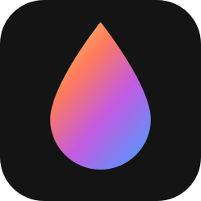
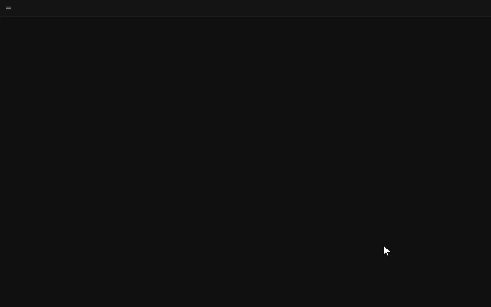
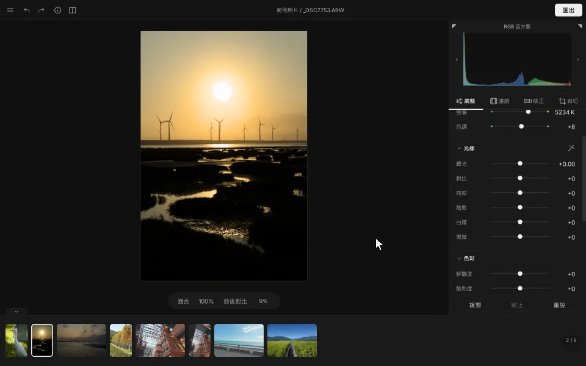
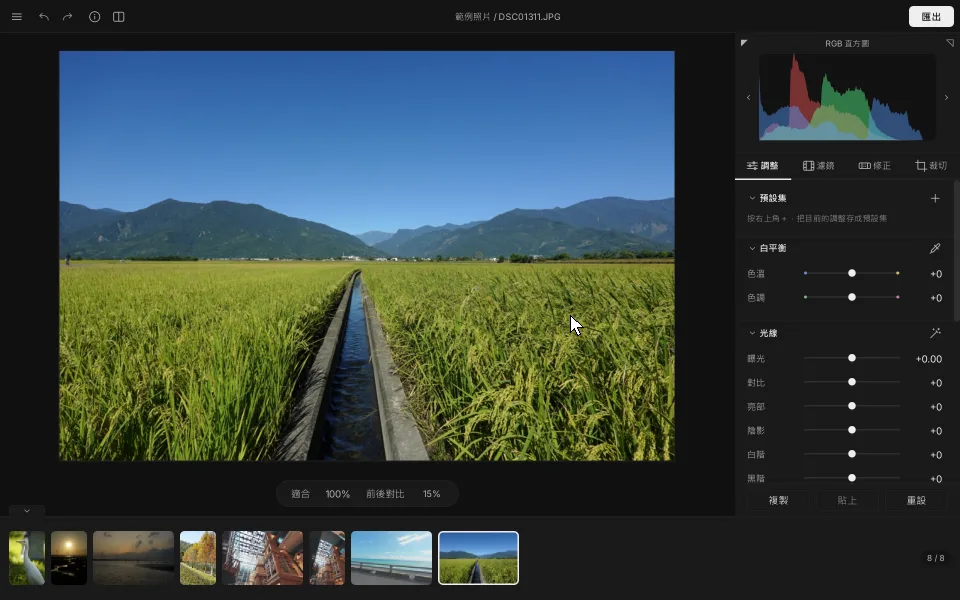
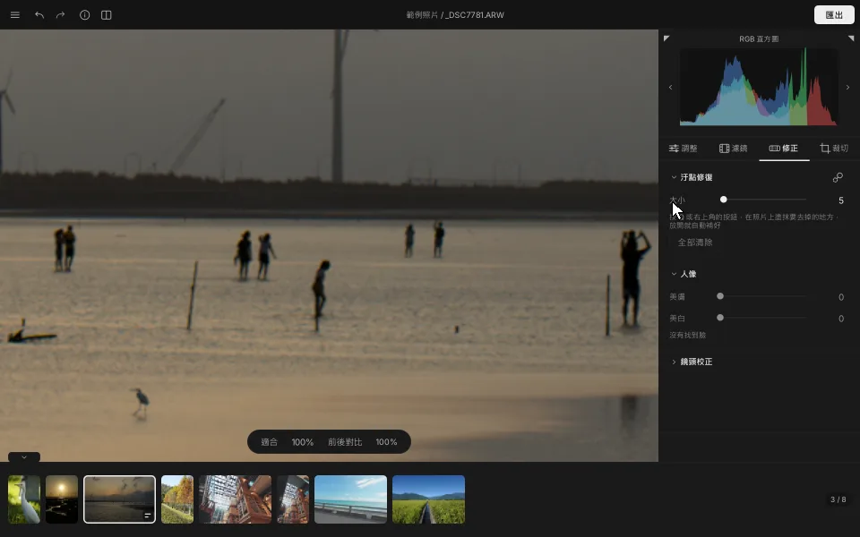
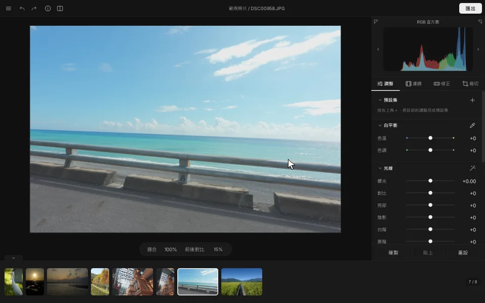
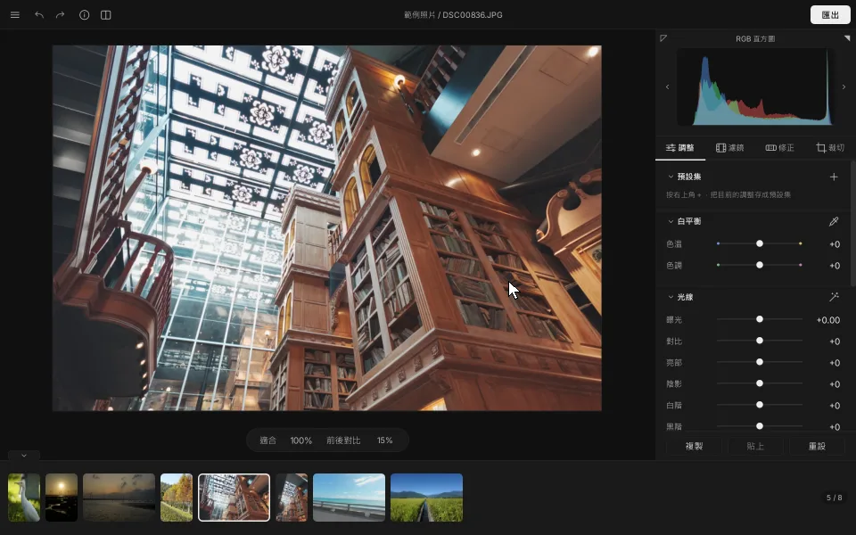
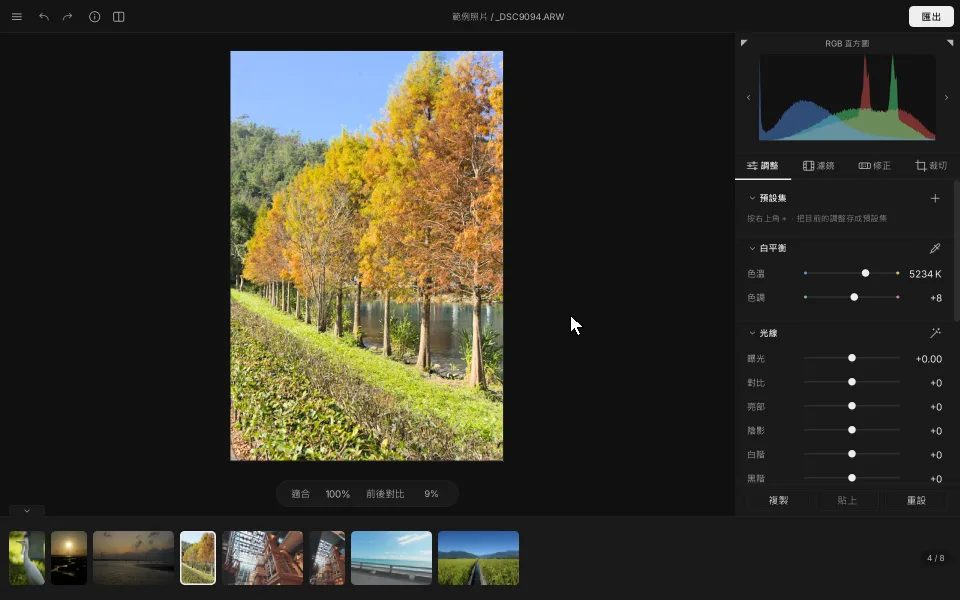

<div align="center">



# TintaPhoto

**準備好為你的回憶，暈染出動人的色彩了嗎？**

一款為攝影愛好者打造的 Windows RAW 修圖軟體。<br>
輕巧、安靜，只把「修好一張照片」這件事做到最好。

[](#系統需求)
[](LICENSE)
[](LICENSE)
[](#系統需求)

### [⬇&nbsp; 免費下載 Windows 版](https://github.com/FEXAQAQ/tintaphoto/releases/latest)

[English](README.en.md) · [下載與安裝](#下載與安裝) · [快速上手](#快速上手) · [更新紀錄](CHANGELOG.md)

<br>



</div>

<br>

## 關於這款軟體

按下快門的那一刻，你看見的不只是畫面，<br>
還有那天的溫度、空氣，和剛好落下的光。

可是回到電腦前，照片常常灰灰的、暗暗的，像是少了點什麼。

**TintaPhoto 就是為了把那一刻找回來。**

打開資料夾，照片一字排開。拖一下滑桿，陰影裡的細節慢慢浮現；點一個濾鏡，整張照片像換了一卷底片。不必建立圖庫、不必匯入目錄、不必訂閱 —— 打開、調色、匯出，就這麼簡單。而你的原始照片，從頭到尾一個位元都不會被改動。

<br>

---

<br>

<div align="center">

<sub>光 線 · LIGHT</sub>

### 陰影裡藏著的，都還在

</div>



RAW 檔記下了相機看見的一切，連你以為黑掉的地方也是。按一下光線群組的魔杖（`Ctrl+U`），曝光、亮部、陰影、白階、黑階自動打好底；再親手拉一點陰影、加一點鮮豔度 —— 每一次拖動，預覽都即時跟上。想知道修了多少？按住 `\`，修圖前後立刻對照。

<br>

<div align="center">

<sub>濾 鏡 · LOOKS</sub>

### 一鍵，換一卷底片

</div>



冷調正片的清冷、濃郁負片的厚實、暖調負片的懷舊，還有色調收斂的自然中片幅，與乾淨俐落的街拍標準、濃烈。六款底片與街拍濾鏡都是拿真實照片一張張量測、擬合出來的色彩，不是隨手調的套色；電影風格的「青橙」讓膚色偏橘、背景與暗部偏青，人物一下子從畫面裡跳出來。每個濾鏡旁邊就是**你這張照片**套上去的縮圖，看了再選；強度從 0 到 100% 自由收放。

<br>

<div align="center">

<sub>汙 點 修 復 · HEAL</sub>

### 把路人，輕輕抹去

</div>



畫面裡多了一個不請自來的路人、一點感光元件上的灰塵、臉上一顆痘痘？在修正分頁按下汙點修復（`Q`），**在照片上塗過去，放開就好了**。
TintaPhoto 會自己從旁邊找到相似的地方補上，紋理和光影都接得自然。每一筆都還能拖動、改大小或刪掉，之後再裁切、旋轉也不會跑掉。

<br>

<div align="center">

<sub>裁 切 · CROP</sub>

### 歪掉的海平面，一筆拉正

</div>



選「拉直」，沿著海平線畫一條線，照片就自己轉正了。原始、自由、1:1，加上橫式 5:4、3:2、16:9、21:9 與它們的直式，一鍵切換，直式貼文、限時動態、桌布，該有的比例都在。還有 90° 旋轉、左右與上下翻轉、三分法格線。

<br>

<div align="center">

<sub>拼 貼 · COLLAGE</sub>

### 幾張照片，說一個故事

</div>



在縮圖列按住 `Ctrl` 選幾張，按下拼貼（`C`），就排成一張社群貼文尺寸的圖。2 到 4 張、左右或上下分割，或排成四宮格，畫布有 9:16、3:4、4:5、1:1、16:9、1.91:1 六種，間距與底色自己決定；同一個場景的日景與夜景，還能疊圖對齊、拖曳接縫，做出日夜接合。匯出時可以順便輸出輪播用的單張：拼好的一張，加上在接縫處切開的每一塊。

反過來也行：按下切割（`S`），把**一張**照片左右、上下平均切成 2 到 4 塊，或切成四宮格，照片上直接畫出切線；匯出時每一塊各存成一個檔案，檔名依序加上 `_a`、`_b`…，拼回去就是原本那張。

<br>

<div align="center">

<sub>匯 出 · EXPORT</sub>

### 修好了，就讓它飛出去

</div>



JPG、PNG、TIFF（8／16 位元），一律輸出標準 sRGB 並嵌入色彩描述檔，傳到手機、社群、沖印店，顏色都和你在螢幕上看到的一樣。可以保留拍攝資訊、一鍵移除 GPS 位置；也能在縮圖列勾選多張，一次全部匯出。

<br>

<sub>（示範中的匯出等待時間以 5 倍速播放。）</sub>

<br>

---

<br>

## 還有這些

| | | |
| --- | --- | --- |
| **白平衡滴管**<br>點一下照片上該是白或灰的地方，色偏就修好了（`W`） | **鏡頭校正**<br>RAW 自動修正變形、色邊與暗角，依相機寫在檔案裡的資料或 Lensfun 鏡頭資料庫 | **一鍵美膚、美白**<br>自動找出臉，只在皮膚上磨皮、提亮、去黃，背景不受影響；人像模式（`P`）裡還能用筆刷自己加入或排除範圍；液化（`L`）可以推、撐、收、轉，修飾臉型與身形，也有眼睛、臉寬、下巴等臉部滑桿 |
| **降噪與銳利化**<br>RAW 一打開就帶一點銳利與色彩降噪，細節群組可再調整 | **底片顆粒與暈影**<br>顆粒以相機實拍的顆粒量測而來，50、100 分別對應弱與強 | **直方圖**<br>RGB 與亮度兩種，過曝、欠曝一眼看出（`H`、`J`） |
| **預設集**<br>把喜歡的調色存起來，點一下套到別張；也能複製貼上到整組照片 | **非破壞編輯**<br>調整存在程式自己的資料夾裡，原檔永遠不會被寫入，照片資料夾也不會多出檔案 | **JPG 原圖直通**<br>沒調整過的 JPG，匯出的像素和原圖完全相同 |
| **熟悉的快捷鍵**<br>沿用修圖軟體常見的按法，換過來不用重練手感 | **整個資料夾一次打開**<br>連子資料夾一起讀，大資料夾也不卡；縮圖會快取 | **繁體中文／English**<br>深色介面，切換語言立即生效 |

<br>

## 為什麼是 TintaPhoto

- **你的原檔，神聖不可侵犯。** 任何情況下都不會寫入、移動或刪除你的照片。所有調整都存在程式自己的資料夾，隨時可以回到原樣。
- **色彩，認真算過。** 全程以 32 位元浮點數在線性光中運算，於寬色域工作空間調色；飽和度只動彩度、不動亮度與色相，輸出前做色域壓縮而不是硬裁切 —— 夕陽與花瓣最飽滿的那一塊，不會糊成一片死色。
- **不打擾。** 沒有圖庫、沒有帳號、沒有雲端、沒有訂閱。打開就用，關掉就走。
- **免費，而且開源。** MIT 授權，程式碼都在這裡。

<br>

## 系統需求

| | 建議配備 |
| --- | --- |
| **作業系統** | Windows 10 或 11（64 位元） |
| **處理器** | 4 核心以上 |
| **記憶體** | 16 GB |
| **儲存空間** | 約 210 MB |
| **讀取格式** | RAW：ARW、CR2、CR3、NEF、RAF、ORF、RW2、DNG（由 LibRaw 解碼）<br>一般圖檔：JPG、PNG（讀取內嵌色彩描述檔，支援 sRGB、Adobe RGB、Display P3） |
| **輸出格式** | JPG、PNG（8／16 位元）、TIFF（8／16 位元），sRGB 並嵌入 ICC |

以 2400 萬像素的 RAW、4 核心 16 GB 的筆電為基準：打開照片約 3 秒內出現預覽，拖曳滑桿 0.1 秒內更新。

<br>

## 下載與安裝

到 [Releases](https://github.com/FEXAQAQ/tintaphoto/releases/latest) 下載最新版，兩種任選：

- **安裝檔** `TintaPhoto-版本-setup.exe` —— 不需要系統管理員權限，會建立開始功能表捷徑，可選擇是否放桌面圖示。解除安裝時會保留你的設定與預設集。
- **免安裝 zip** `TintaPhoto-版本-windows-x64.zip` —— 解壓縮到任何地方（路徑有中文或空白也沒關係），執行 `TintaPhoto.exe` 即可。不需要 Python，也不寫入登錄檔。

> [!NOTE]
> 因為程式沒有數位簽章，第一次執行時 Windows 可能會顯示「Windows 已保護您的電腦」。
> 按 **其他資訊** → **仍要執行** 就能開啟。

設定與預設集存在 `%APPDATA%\TintaPhoto`，縮圖快取在 `%LOCALAPPDATA%\TintaPhoto`；不要了就把這兩個資料夾一起刪掉。

<br>

## 快速上手

1. 把資料夾拖進視窗，或按 `Ctrl+Shift+O` 開啟資料夾。
2. 在下方縮圖列點一張照片，用 `←` `→` 切換。
3. 右側四個分頁：**調整**（`Ctrl+1`）、**濾鏡**（`Ctrl+2`）、**修正**（`Ctrl+3`）、**裁切**（`Ctrl+4`）。
4. 按住 `\` 看修圖前後；`Ctrl+Z` 復原、`Ctrl+Y` 重做；雙擊滑桿名稱可以歸零。
5. 按右上角的 **匯出**（`Ctrl+Shift+E`）。

<details>
<summary>更多快捷鍵</summary>

| 動作 | 快捷鍵 |
| --- | --- |
| 開啟檔案／資料夾 | `Ctrl+O` ／ `Ctrl+Shift+O` |
| 自動調整光線 | `Ctrl+U` |
| 白平衡滴管 | `W` |
| 汙點修復／筆刷大小／刪除 | `Q` ／ `[` `]` ／ `Delete` |
| 人像／液化 | `P` ／ `L` |
| 進入裁切／套用／取消 | `R` ／ `Enter` ／ `Esc` |
| 裁切直橫互換／格線 | `X` ／ `O` |
| 旋轉 90° | `Ctrl+[` ／ `Ctrl+]` |
| 左右／上下翻轉 | `Shift+H` ／ `Shift+V` |
| 複製／貼上調整 | `Ctrl+Shift+C` ／ `Ctrl+Shift+V` |
| 存成預設集 | `Ctrl+Shift+N` |
| 拼貼 / 切割 | `C` / `S` |
| 100% 檢視／縮放／符合視窗 | `Z` ／ `Ctrl+＋` `Ctrl+−` ／ `Ctrl+0` |
| 平移放大的照片 | 按住空白鍵拖曳 |
| 過曝欠曝提示／直方圖切換 | `J` ／ `H` |
| 照片資訊 | `I` |
| 隱藏所有面板／全螢幕 | `Tab` ／ `F` |

完整清單在選單的「設定」→「快捷鍵」，可以直接搜尋。

</details>

<br>

## 給開發者

TintaPhoto 以 Python 3.12 與 PySide6 撰寫，RAW 解碼使用 LibRaw（透過 rawpy）。

- 從原始碼執行、測試、打包安裝檔：[docs/BUILDING.md](docs/BUILDING.md)
- 需求、介面規格與影像處理流程：[docs/PLAN.md](docs/PLAN.md)
- 開發進度：[docs/PROGRESS.md](docs/PROGRESS.md)　·　開發日誌：[docs/DEVLOG.md](docs/DEVLOG.md)　·　版本變更：[CHANGELOG.md](CHANGELOG.md)

```powershell
py -3.12 -m venv .venv
.venv\Scripts\Activate.ps1
pip install -e ".[dev]"
python main.py
```

<br>

## 授權

程式碼以 [MIT 授權](LICENSE) 釋出。第三方元件與授權列在 [THIRD_PARTY_NOTICES.md](THIRD_PARTY_NOTICES.md)，完整授權條文在 [licenses/](licenses)。

本頁示範動圖中的照片由作者拍攝，著作權歸作者所有，不在 MIT 授權範圍內。

## 聲明

本專案與任何軟體公司或相機製造商無關，也未獲其認可，不包含它們的程式碼、圖示或相機描述檔。

底片、中片幅與街拍的六款濾鏡都是本專案自行擬合的近似風格：以照片的 RAW 檔經本程式顯影的結果，對照相機同一次快門寫出的 JPG，用最小平方法量測出來；「濃烈」是「標準」的同一份量測再提高彩度。量測用的樣張只用來計算，不包含在本專案或程式中。電影風格的「青橙」沒有相機可量，是由 `tools/design_filter.py` 依一份寫明各色調整的配方產生的。這些濾鏡使用本專案自己的名稱，不是任何廠商底片模擬、描述檔或查找表的複製品，也不宣稱與之相同。
